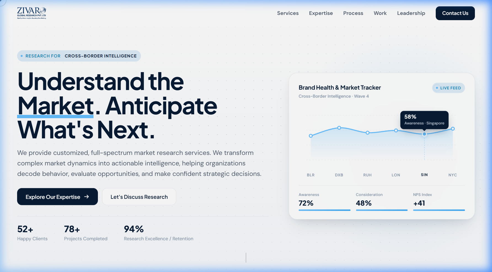
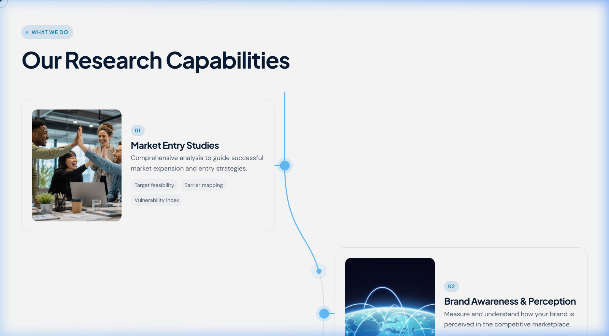

# Zivaro Global Research Pvt. Ltd.

[](https://vitejs.dev/)
[](https://reactjs.org/)
[](https://tailwindcss.com/)
[](https://greensock.com/gsap/)
[](https://www.framer.com/motion/)

A premium, interactive web experience built for **Zivaro Global Research Pvt. Ltd.** — a premier strategic intelligence and full-spectrum market research advisory firm. Designed with bespoke micro-interactions, GSAP ScrollTrigger animations, interactive canvas elements, and a high-editorial visual aesthetic.

---

## 📸 Previews

### Hero & Live Intelligence Board


### Scroll-Drawn Research Capabilities


---

## ✨ Key Features

- **Interactive Canvas & Hero Section**: Dynamic particle canvas with fluid cursor interactions, animated headline rotations, live metrics ticker, and an interactive **Brand Health & Market Tracker** card with multi-region live feeds (BLR, DXB, RUH, LON, SIN, NYC).
- **Sticky & Adaptive Navbar**: Smooth header featuring a dynamic reading scroll progress bar, auto-hide on downward scroll, and frosted glass backdrop blur.
- **Scroll-Drawn Research Capabilities**: Interactive SVG curved journey line synchronized with scroll progress, presenting core capabilities:
  - Market Entry Studies & Feasibility
  - Brand Awareness & Perception Tracking
  - Consumer Behavior & Qualitative Insights
  - Customer Satisfaction & NPS Diagnostics
  - Competitive Intelligence & Benchmarking
  - Product Concept & Packaging Testing
- **Industry Verticals & Marquee**: Interactive expanding vertical panels and continuous marquee ticker covering Automotive, B2B, Finance, Healthcare, FMCG, Tech, and more.
- **Methodology Framework**: 4-stage stacking deck illustrating the end-to-end research lifecycle from Discovery & Design to Actionable Recommendations.
- **Editorial Insights & Case Studies**: Draggable research carousel highlighting deep-dive reports, whitepapers, and market forecasts.
- **Founder-Led Directorship**: Executive showcase highlighting leadership profiles, corporate philosophy, and advisory credentials.
- **Inquiry & RFP Form**: Direct inquiry form with interactive service selectors and instant validation.
- **Custom Interactive Cursor**: Smooth-lagging cursor with hover state expansion and interaction feedback.

---

## 🛠️ Tech Stack

- **Core**: [React 18](https://react.dev/) + [Vite](https://vitejs.dev/)
- **Styling**: [Tailwind CSS](https://tailwindcss.com/) + Custom CSS Design Tokens
- **Animations & Interaction**:
  - [GSAP (GreenSock)](https://greensock.com/gsap/) with [ScrollTrigger](https://greensock.com/scrolltrigger/)
  - [Framer Motion](https://www.framer.com/motion/)
- **Icons**: [Lucide React](https://lucide.dev/)
- **Utility**: `clsx`, `tailwind-merge`

---

## 🚀 Getting Started

### Prerequisites

Ensure you have [Node.js](https://nodejs.org/) (v18 or higher recommended) and `npm` installed on your machine.

### Installation

1. **Clone the repository:**
   ```bash
   git clone https://github.com/vishveshvar/zivaro-global-research-website.git
   cd zivaro-global-research-website
   ```

2. **Install dependencies:**
   ```bash
   npm install
   ```

3. **Start the development server:**
   ```bash
   npm run dev
   ```
   Open your browser and navigate to `http://localhost:5173`.

4. **Build for production:**
   ```bash
   npm run build
   ```

5. **Preview production build:**
   ```bash
   npm run preview
   ```

---

## 📂 Project Structure

```text
├── public/                 # Static assets, branding, and images
│   └── assets/img/         # Sector photography and company logos
├── screenshots/            # Showcase screenshots for documentation
│   ├── hero-preview.png
│   └── capabilities-preview.png
├── src/
│   ├── components/         # Modular UI components
│   │   ├── BrandHealthCard.jsx
│   │   ├── Contact.jsx
│   │   ├── Cursor.jsx
│   │   ├── Footer.jsx
│   │   ├── Hero.jsx
│   │   ├── Industries.jsx
│   │   ├── Insights.jsx
│   │   ├── Leadership.jsx
│   │   ├── Methodology.jsx
│   │   ├── Metrics.jsx
│   │   ├── Navbar.jsx
│   │   ├── Reach.jsx
│   │   └── Services.jsx
│   ├── utils/              # GSAP & ScrollTrigger initialization
│   │   └── gsap.js
│   ├── App.jsx             # Main application layout
│   ├── index.css           # Global typography & design system tokens
│   └── main.jsx            # React root entry point
├── index.html              # HTML shell & SEO meta configuration
├── package.json            # Project manifest & dependencies
├── tailwind.config.js      # Tailwind theme configuration
└── vite.config.js          # Vite configuration
```

---

## 📄 License

This project is proprietary and confidential to **Zivaro Global Research Pvt. Ltd.** All rights reserved.
